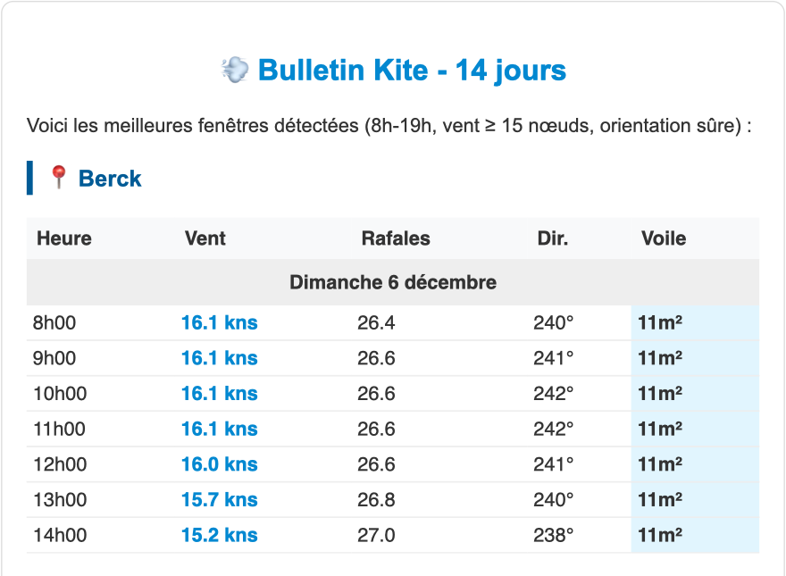

# Kite App : alertes vent et carte des spots

[](https://github.com/Codzn/Kite_APP_/actions/workflows/tests.yml)

[](LICENSE)

**Un outil Python qui analyse les prévisions de vent pour trouver les bons créneaux de kitesurf sur la Côte d'Opale, puis les envoie par e-mail chaque matin.**

## Pourquoi ce projet

Pratiquer le kitesurf demande de surveiller la météo en permanence : il faut assez de vent, mais aussi un vent qui vient de la mer, sinon la session devient dangereuse. Consulter plusieurs sites chaque jour pour trois plages prend du temps, et on rate facilement une bonne fenêtre.

J'ai donc automatisé cette veille : chaque matin, le programme analyse les 14 prochains jours sur **Berck**, **Dunkerque** et **Wissant** et m'envoie uniquement les créneaux navigables, avec la taille de voile conseillée.

<p align="center">
  
</p>

## Fonctionnalités

- **Alerte quotidienne par e-mail** (`alerte.py`), lancée automatiquement par GitHub Actions.
- **Carte interactive** (`map.py`) réalisée avec Streamlit et Folium : le vent en temps réel sur chaque spot (marqueur vert ou rouge) et le calcul d'itinéraire depuis son point de départ, en voiture, à vélo ou à pied.
- **Conseil de voile** selon la force du vent : 11 m² dès 15 nœuds, 9 m² dès 20 nœuds, 7 m² dès 25 nœuds.

## Comment un créneau est sélectionné

Pour chaque heure des 14 prochains jours, trois filtres sont appliqués :

| Filtre | Règle | Pourquoi |
|---|---|---|
| Horaire | entre 8 h et 19 h | naviguer de jour uniquement |
| Force | vent moyen ≥ 15 nœuds | en dessous, impossible de planer |
| Direction | vent venant de la mer | un vent de terre pousse vers le large : danger |

Chaque plage a sa propre plage de directions sûres. Pour Wissant, elle va de 220° à 60° en **passant par le nord (0°)**, ce qui demande une comparaison particulière : la direction doit être supérieure à 220° **ou** inférieure à 60°.

Ces règles sont regroupées dans `kite_logic.py`, partagé par l'alerte et la carte, et couvertes par des tests automatiques.

## Architecture

```text
Open-Meteo API ──► alerte.py ──► filtres (kite_logic.py) ──► e-mail HTML ──► Gmail SMTP
                                                    ▲
Open-Meteo + OpenRouteService ──► map.py (Streamlit) ┘
```

```text
Kite_APP_/
├── alerte.py           # alerte quotidienne par e-mail
├── map.py              # carte interactive Streamlit
├── kite_logic.py       # règles métier partagées (spots, filtres, voile)
├── tests/              # tests pytest, sans appel aux API
├── docs/alerte.png     # capture de l'e-mail
└── .github/workflows/  # alerte programmée et tests à chaque push
```

## Technologies

| Technologie | Usage |
|---|---|
| Python, Pandas | Traitement des séries temporelles de prévisions |
| Open-Meteo API | Prévisions de vent (vitesse, rafales, direction) |
| requests-cache, retry-requests | Cache et nouvelles tentatives automatiques en cas d'erreur réseau |
| Streamlit, Folium | Interface web et carte interactive |
| OpenRouteService, Geopy | Calcul d'itinéraire et géocodage d'adresse |
| smtplib | Envoi de l'e-mail via Gmail |
| pytest | Tests automatiques |
| GitHub Actions | Exécution quotidienne et tests à chaque push |

## Installation

```bash
git clone https://github.com/Codzn/Kite_APP_.git
cd Kite_APP_
python -m venv .venv
source .venv/bin/activate
pip install -r requirements.txt
```

Créer un fichier `.env` à la racine (il n'est jamais envoyé sur GitHub) :

```env
EMAIL_USER=destinataire@example.com
EMAIL_FROM=expediteur@gmail.com
MDP_EMAIL=mot_de_passe_application_gmail
API_KEY=cle_openrouteservice   # uniquement pour la carte
```

Pour Gmail, il faut utiliser un **mot de passe d'application**, pas le mot de passe du compte.

## Utilisation

```bash
python alerte.py        # analyse les prévisions et envoie l'e-mail
streamlit run map.py    # ouvre la carte interactive dans le navigateur
pytest                  # lance les tests
```

## Automatisation

- **Alerte quotidienne** (`.github/workflows/main.yml`) : chaque jour à 7 h UTC, GitHub lance les tests puis `alerte.py`. Les identifiants e-mail sont stockés dans les secrets du dépôt (`EMAIL_USER`, `EMAIL_FROM`, `MDP_EMAIL`).
- **Tests** (`.github/workflows/tests.yml`) : à chaque push, le code est vérifié et testé sans envoyer d'e-mail.

## Ce que j'ai appris

- **Traduire une expertise métier en règles de code.** Ma connaissance du kitesurf (force minimale, vent de terre dangereux, taille de voile) est devenue des filtres simples et testables.
- **Manipuler des séries temporelles avec Pandas** : reconstruire les dates à partir de timestamps Unix, convertir les fuseaux horaires et filtrer heure par heure.
- **Gérer les cas limites**, comme une plage de directions qui traverse le nord (de 220° à 60°).
- **Rendre un programme fiable face au réseau** grâce au cache et aux nouvelles tentatives automatiques.
- **Construire une interface** avec Streamlit et Folium, en combinant plusieurs API (météo, géocodage, itinéraire).
- **Automatiser avec GitHub Actions** et protéger ses identifiants avec des secrets.

## Pistes d'amélioration

- Tenir compte des rafales : un écart trop grand avec le vent moyen rend la session difficile.
- Ajouter les horaires de marée, importants sur la Côte d'Opale.
- Permettre à chacun de choisir ses spots et son seuil de vent.

## Licence

Ce projet est publié sous [licence MIT](LICENSE).
